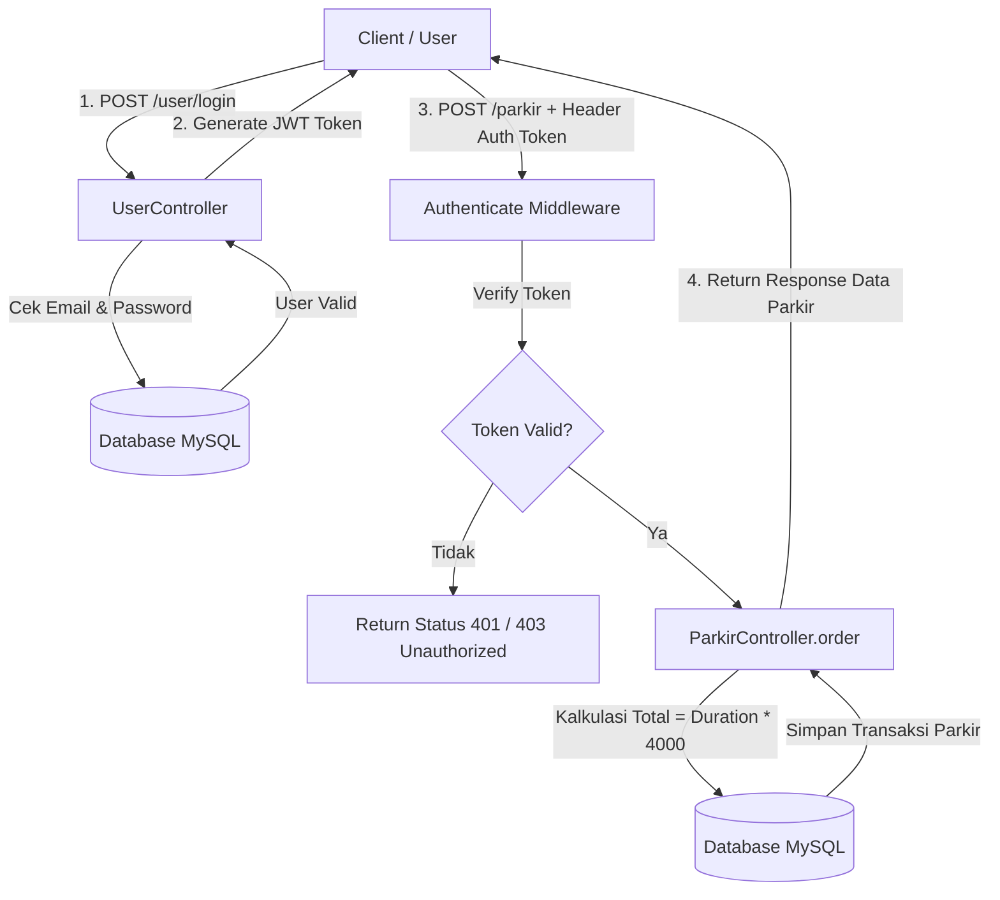

# 🚗 Parking Backend System (parking-be)

RESTful API backend untuk Sistem Manajemen Parkir berbasis Node.js, Express.js, dan Sequelize ORM dengan Autentikasi JWT (JSON Web Token).

---

## 📌 Fitur Utama

- 🔐 **Autentikasi & Otorisasi JWT**: Registrasi, login dengan hashing password (Bcrypt), dan verifikasi token pada endpoint privat.
- 👤 **Manajemen User**: CRUD lengkap untuk data pengguna.
- 🅿️ **Manajemen Parkir**: 
  - Pemesanan tiket parkir (Kalkulasi otomatis tarif parkir berdasarkan durasi).
  - Monitoring transaksi parkir khusus milik pengguna yang sedang terautentikasi.
  - Pembatalan / hapus transaksi parkir.
- 🌐 **Integrasi API Eksternal**: Fetching data *Bitcoin Price Index / Asset Quotation* secara asynchronous.

---

## 🛠️ Teknologi yang Digunakan

- **Runtime**: [Node.js](https://nodejs.org/) (ES Modules)
- **Framework**: [Express.js v5](https://expressjs.com/)
- **ORM**: [Sequelize](https://sequelize.org/)
- **Database**: [MySQL](https://www.mysql.com/) (`mysql2`)
- **Autentikasi**: [JSON Web Token (jsonwebtoken)](https://jwt.io/) & [Bcrypt](https://www.npmjs.com/package/bcrypt)
- **HTTP Client**: [Axios](https://axios-http.com/)

---

## 📊 Flowchart System

### 1. Alur Autentikasi & Pemesanan Parkir (Parking Order Flow)



### 2. Struktur Endpoint API

| Method | Endpoint | Auth Required | Deskripsi |
| :--- | :--- | :---: | :--- |
| `POST` | `/user/register` | ❌ | Registrasi akun baru |
| `POST` | `/user/login` | ❌ | Login akun & dapatkan JWT Token |
| `GET` | `/user/me` | ✅ | Ambil profil user yang sedang login |
| `GET` | `/user` | ❌ | Menampilkan daftar seluruh user |
| `GET` | `/user/:id` | ❌ | Menampilkan detail user berdasarkan ID |
| `PUT` | `/user/:id` | ❌ | Update data user |
| `DELETE` | `/user/:id` | ❌ | Hapus user |
| `GET` | `/parkir` | ✅ | Menampilkan daftar transaksi parkir user |
| `POST` | `/parkir` | ✅ | Membuat transaksi parkir baru |
| `PUT` | `/parkir/:id` | ✅ | Mengubah data transaksi parkir |
| `DELETE` | `/parkir/:id` | ✅ | Membatalkan transaksi parkir |
| `GET` | `/bitcoin-price-index` | ❌ | Integrasi eksternal data harga crypto |

---

## 🚀 Cara Menjalankan Project

### 1. Prasyarat
- Node.js (v18+)
- MySQL Database Engine

### 2. Instalasi Dependensi
```bash
npm install
```

### 3. Konfigurasi Database
Pastikan konfigurasi koneksi database MySQL pada `model/connection.js` sudah disesuaikan dengan environment lokal Anda.

### 4. Menjalankan Server
```bash
node app.js
```
Server akan berjalan di port `4000`: `http://localhost:4000`

---

## 📁 Struktur Direktori Project

```text
parking-be/
├── controllers/
│   ├── ParkirController.js   # Logic bisnis transaksi parkir
│   └── UserController.js     # Logic auth & manajemen user
├── middleware/
│   └── authenticate.js       # Middleware verifikasi JWT Token
├── model/
│   ├── connection.js         # Konfigurasi Sequelize DB
│   ├── parkir.js             # Model Data Parkir
│   └── user.js               # Model Data User
├── app.js                    # Entry point aplikasi Express
├── router.js                 # Routing endpoint API
├── package.json              # Manifest dependensi & scripts
└── README.md                 # Dokumentasi project
```
